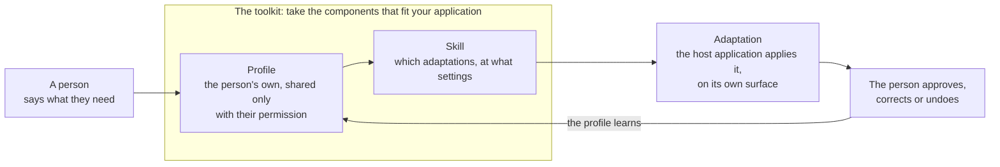
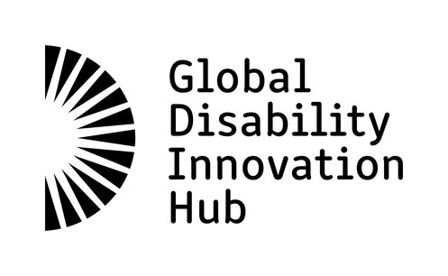

# AI for Accessibility Toolkit

**An open toolkit for building apps that adapt to each person's accessibility needs.**

[](LICENSE)

[What it is](#what-it-is) · [Key terms](#key-terms) · [Who it's for](#who-its-for) · [Try it](#try-it) · [Contributing](#contributing) · [Docs](docs/README.md)

---

**Not a developer?** The browser extensions built on this toolkit are in the
[extension repository](https://github.com/AI-for-Accessibility-Collective/AI-for-Accessibility-Extension),
with an install guide that needs no coding. There's also a plain-language
overview in [docs/TLDR.md](docs/TLDR.md).

## What it is

The toolkit is a set of parts a developer can use to make an app adapt to a
person. It can:

- learn what a person needs, e.g., larger text or fewer animations,
- keep those needs in a profile on the person's device,
- and turn the profile into skills, which are sets of adaptations that change
  the app for that person.

You choose which parts to use and how your app uses them.



A person says what they need, the profile picks skills that fit, your app
applies the adaptations, and the person can approve, correct or undo each one.
The profile learns from those choices.

The same profile works across platforms. For example, a profile with larger
text (`textSize` 1.5), a dark theme and reduced motion becomes these settings
in the renderers in [`toolkit/surfaces/`](toolkit/surfaces/):

| Surface | What the host receives |
|---|---|
| `web.js` | `{ "fontScale": 150, "darkMode": true, "motionReducer": true }` |
| `mobile.js` | `{ "text": { "scalePercent": 150, ... }, "display": { "darkMode": true, ... }, "motion": { "reduceMotion": true }, "touch": { "minTargetPt": 44 }, ... }` |
| `xr.js` | `{ "text": { "angularSizeDeg": 0.525, "worldHeightM": 0.014 }, "ui": { "maxEccentricityDeg": 20, "darkEnvironmentPreferred": true }, "motion": { "reduced": true, "comfortVignette": true, "snapTurning": true }, ... }` |

The mobile settings use the same names as the accessibility settings in iOS
and Android. The XR renderer gives text size as an angle at the eye, since a
font size doesn't mean much in a headset. A person only needs to set up their
profile once to use it on all three.

### Key terms

These four words are used throughout the docs. The code uses its own names for
them, listed in the last column. See [docs/GLOSSARY.md](docs/GLOSSARY.md) for
every term and [docs/architecture.md](docs/architecture.md) for how the parts
fit together.

| Word | Meaning | In the code |
|---|---|---|
| **Need** | What a person says they need, in their own words | free text, `supportAreas`, onboarding steps, `needs[]` entries |
| **Profile** | What the toolkit knows about a person's needs, shared with other apps only with the person's permission | the **AbilityModel** (the profile in a form every renderer can read) and the **Librarian** (the agent that keeps the profile, learns from setting changes, and controls what other apps can read); grants, no-memory zones, the proposal queue |
| **Skill** | Which adaptations to apply, and with what settings, for a need | a `SKILL.md` recipe; the **Engineer** (the agent that writes a skill from a person's need and profile, which the person checks before it's saved); the registry in `toolkit/registry/` |
| **Adaptation** | A change an app makes for the person | adapter modules in `tools/adapters/`; auditors; validators; presets; renderers; the ports an app implements |

## What it isn't

- **Not an auditor.** An auditor scans a site and gives the developer a report.
  This toolkit changes an app for the person using it, based on their profile.
- **Not an overlay.** An overlay is added by a site owner and gives everyone
  the same widget. With this toolkit, each person's own profile decides what
  changes, and site owners don't install anything.
- **Not assistive technology.** It doesn't replace a screen reader, a
  magnifier or anything else a person relies on.
- **Not an app or a browser project.** The core has no user interface. We
  started with the browser because it was the easiest way to get feedback from
  people, but web, mobile, XR, desktop and server apps are all supported.

## Status

This is a research prototype (pre-alpha), and things may break or change
without notice. The adaptations in the catalog are demos and haven't been
formally validated with the people they're meant for. The presets are
starting points based on published research (see
[docs/PROFILE-CARDS.md](docs/PROFILE-CARDS.md)).

The toolkit comes from the
[AI for Accessibility Collective](docs/HOW-THIS-WAS-BUILT.md). The current
research phase ends in November 2026, and plans after that aren't decided yet.
Open work is listed in [ROADMAP.md](ROADMAP.md).

## Who it's for

- People who want pages adapted to them: use the browser extensions in the
  [extension repository](https://github.com/AI-for-Accessibility-Collective/AI-for-Accessibility-Extension),
  and tell us how they work for you.
- Developers building an app on the web, mobile, XR, desktop or a server: use
  any mix of the core, the skills and the catalog.
- Developers extending the toolkit: add skills, adapters, auditors and presets
  (see [CONTRIBUTING.md](CONTRIBUTING.md)).
- Researchers working on AI agents: use the design principles and the
  architecture, and share benchmarks, evaluation methods and findings.

## Try it

No install, API key or browser needed. From a clone of the repository:

```bash
node toolkit/hosts/xr-demo/demo.js      # a profile made on the web is shared with an XR app
node toolkit/hosts/skill-demo/demo.js   # finds, builds, checks and saves a skill
node examples/cross-surface.mjs         # one profile turned into web and XR settings
```

[docs/QUICKSTART.md](docs/QUICKSTART.md) walks through the code, and
[`toolkit/API.md`](toolkit/API.md) lists every method.

To see a whole app built on it, run the
[reader demo](https://github.com/AI-for-Accessibility-Collective/ai4a11y-reader-demo):
a one-page reading app you talk to ("bigger text", "I'm dyslexic", "read
this") that keeps the person's needs in the toolkit and renders them with the
catalog. Its README is a tutorial for building your own host; it needs a
Gemini key.

## Building on it

There are four ways to use the toolkit:

1. Use the core directly in any JavaScript runtime. `createToolkit({ ports })`
   returns `{ datastore, librarian }`. Implement the ports for your platform,
   starting from the Node version in
   [`toolkit/platforms/node/`](toolkit/platforms/node/). There's also a Chrome
   version in [`toolkit/platforms/chrome/`](toolkit/platforms/chrome/).
2. Call the hosted service from any language. Run [`server/`](server/) locally
   or on Cloud Run, and call the same Librarian methods over HTTP with a bearer
   token (see [server/README.md](server/README.md)).
3. Use the catalog. The skills, adapters, auditors and presets in
   [`tools/`](tools/) and the registry in
   [`toolkit/registry/`](toolkit/registry/) work with or without the core.
4. Use one of the experimental parts: a Controller that drives apps by text or
   voice, an example onboarding service, or a command-line tool (CLI).

[docs/COMPONENTS.md](docs/COMPONENTS.md) has more on each.

### What your app needs to provide

- Ports: a `KVStore` is required, and `Clock`, `Scheduler` and `Consent` have
  defaults.
- An actuation port, if your app applies changes to a live page or screen.
- An LLM caller, if you want the AI features.
- An onboarding step that records a person's needs in their profile.

> **Note**: the default `Consent` does nothing, so if you don't connect your
> own, the toolkit's suggested profile changes are never shown to anyone.

Without an AI provider, everything except the AI features still works, and
adapters return fewer results instead of failing. See
[docs/COMPONENTS.md](docs/COMPONENTS.md#what-a-host-implements) for details,
including the two places AI plugs in.

## Contributing

[CONTRIBUTING.md](CONTRIBUTING.md) explains how to set up the repository and
open a pull request. The main ways to contribute are:

- [Share feedback](CONTRIBUTING.md#share-feedback) on the toolkit or the
  extensions
- [Write a skill](CONTRIBUTING.md#write-a-skill) (no code needed)
- [Add an adapter](CONTRIBUTING.md#add-an-adapter)
- [Add an auditor](CONTRIBUTING.md#add-an-auditor)
- [Build an example app](CONTRIBUTING.md#build-an-example-app)

If you're building an app with the toolkit, it's still your job to make the
app accessible. Adapters fix problems after the fact, so it's better to plan
for accessibility from the start. The
[W3C guide to planning accessibility](https://www.w3.org/WAI/planning-and-managing/)
is a good place to begin.

## Security and license

To report a vulnerability, see [SECURITY.md](SECURITY.md). It also lists what
to know before deploying, e.g., how API keys and profile ids are handled.

Only the Librarian writes to a person's profile, the toolkit doesn't keep
notes on sensitive kinds of sites (finance, health and government by
default), and other apps can read a profile only with a grant the person can
revoke.

Licensed under Apache 2.0 ([LICENSE](LICENSE)).

## Repository layout

```
toolkit/     Platform-agnostic core: Librarian, datastore, ability model, grants,
             skill engine, ports, sync, protocol, surfaces, the tools registry,
             reference platform bindings, and the runnable demo hosts
tools/       Developer catalog: adapters, auditors, validators, profiles, utils,
             and the ArtInsight knowledge module under insights/
controller/  Optional text/voice control surface: ControlPort, grammar, mounts,
             remote transport, web UI, demo (a sibling; the core never depends on it)
server/      Hosted HTTP service exposing the core to any language/runtime
cli/         Experimental Python CLI: try the catalog on a live page from a terminal
onboarding/  Example web service: /chat, /onboarding, /controller on one port
examples/    A runnable, dependency-free example
docs/        Quick start, glossary, components, architecture, design docs
scripts/     Repository checks (the packed-package fixture)
```

The paths that changed when the extensions moved to their own repository are
listed at the top of [docs/README.md](docs/README.md). Who built this and how:
[docs/HOW-THIS-WAS-BUILT.md](docs/HOW-THIS-WAS-BUILT.md).

---

<h2 align="center">AI for Accessibility Collective</h2>

<div align="center">
<p>
  <a href="https://www.stanford.edu/"></a>
  &nbsp;&nbsp;
  <a href="https://www.washington.edu/"></a>
  &nbsp;&nbsp;
  <a href="https://www.media.mit.edu/"></a>
  &nbsp;&nbsp;
  <a href="https://www.disabilityinnovation.com/"></a>
  &nbsp;&nbsp;
  <a href="https://www.google.org/"></a>
</p>
</div>
