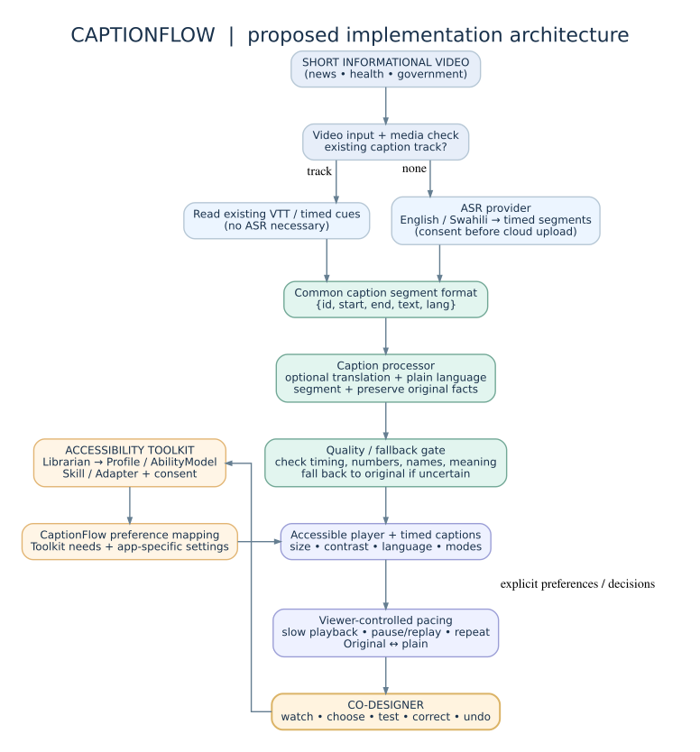
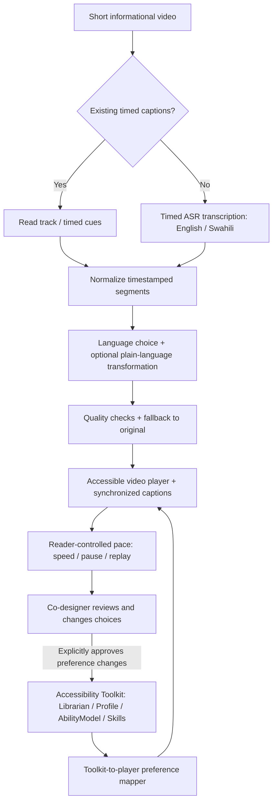

# CaptionFlow — Implementation Blueprint

**Target:** AI for Accessibility Hackathon, Saturday 7 November 2026  
**Base toolkit revision (uploaded snapshot):** `9bb42e10ece3b7b0f2e6c2d1384e023d73e278b3`  
**Status:** Proposed implementation plan; not a completed or user-validated product. The co-designer decides the final accessibility priorities.

## Mission
Help a Deaf KSL user follow short Kenyan news, public-service and health videos using synchronized, plain English or Swahili captions with viewer-controlled pacing. KSL-first does **not** automatically mean captions are an adequate substitute for KSL; validate usefulness with the co-designer.

## Visual architecture

### Grounded existing toolkit functionality
- `tools/adapters/show-captions.js`: activates existing tracks or some player CC controls, with native-track restoration; 14 tests passed on user's machine.
- `tools/adapters/generate-captions.js`: delegates to `transcribeVideo(src)` then creates VTT in 10-word, five-second chunks; not real alignment.
- `tools/adapters/auto-transcriber.js`: additional player CC overlay, but host wiring/catalog mapping is inconsistent. Do not assume it is the primary implementation.
- `tools/adapters/simplify-text.js`: processes HTML prose of 100–10,000 characters, with original toggle and output checks; not for timed caption cues. User's unit test reported 35 passes and a CSS parsing warning.
- `tools/utils/ai.js`: AI provider interface, not a working English/Swahili timed-ASR provider by itself.
- `toolkit/core/{ability,datastore,librarian}.js`, `toolkit/core/skill.js`, `toolkit/skills/builtin/quiet-video.md`: profile/skills foundations. `toolkit/platforms/chrome/web-surface.js` maps captions/simplification needs to web settings.
- `tools/adapters/translate-page.js`: page text translation, not a caption translator. It does not natively include Swahili in its `LANG_CODES` map.

**Integration contracts (proposed, not current toolkit API)**

1. **Input:** `{ videoId, sourceUrlOrFile, consent, existingTrack? }`; support a locally controlled sample for a reliable demo.
2. **Normalized timed transcript:** `{ videoId, sourceLanguage, segments: [{ id, start, end, text, language? }] }`. Require `0 <= start < end`, monotonic timing, and IDs.
3. **Processed captions:** `{ id, start, end, originalText, displayText, language, mode, status }`. Preserve every original; transformation does not silently alter authoritative facts.
4. **Preferences:** `{ captionLanguage: 'en'|'sw', mode: 'original'|'plain', fontScale, paceMode, contrastMode }`. Map supported needs through the toolkit; keep unrecognized caption-specific preferences at host layer until deliberately registered.
5. **Player:** `render(video, timedCues, preferences)`. Never couple it to specific ASR/LLM provider.

## Preferred MVP order

1. **Reliable fixture path**: locally controlled 30–90-second video, timestamped transcript fixture, player captions.
2. **Viewer control**: caption mode, font scale, English/Swahili where genuinely supported, playback speed, pause/replay; no AI needed for controls.
3. **Toolkit integration**: profile → AbilityModel/skill → caption preferences, reversible changes.
4. **Real ASR**: swap fixture for timed transcription, handle loading/errors and cloud consent.
5. **Plain-language transformation**: rewrite with factual checks, original toggle and clear uncertainty/fallback.
6. **Co-designer refinement**: change the features and thresholds they prefer; do not assume initial choices are correct.

Do **not** promise streaming real-time captions for arbitrary YouTube/DRM video. The first MVP should generate a caption track for a controlled short clip and synchronize it as the video plays; genuine live streaming requires a separate feasibility assessment.

## Critical tests

- **Timed transcription:** timestamps within clip bounds, ordered, sentence starts near speech onset; English/Swahili short clips; error/timeout/no-speech; source access; provider credentials not exposed.
- **Caption transformation:** retains dates, numbers, names and medical advice; returns original on failure; records transformation separately from source; script/language chosen; cannot claim quality from ratio checks alone.
- **Playback:** captions appear at correct time; playback speed affects video and captions together; pause/replay navigation; no unbounded automatic changes; keyboard, touch, small phone screen and legible contrast.
- **Profile:** explicit need maps to settings; updates are reversible; no implied co-designer approval; profile is not sent to AI provider without consent.
- **End-to-end:** sample video → timed segments → plain/original captions → player → preference change → visible outcome.
- **Co-designer:** test independently with co-designer and interpreter as needed, measuring successful following of short content, ease of controlling pace, and preference/comfort. Do not use these tests to judge the person's reading ability.

## Pull request quality gate

- Feature branch based on current `dev`; PR targets `dev`; no direct `main` changes.
- The branch contains a small runnable demo or fixture and test evidence.
- Run existing root tests: `npm test`, `npm --prefix server test`; `npm run test:e2e` where relevant. The known `npm run validate:browser` translation timeout should be reported, not falsely marked green.
- Run feature-specific tests created by the owner. If using Node's built-in test runner: `node --test captionflow/tests/<feature>.test.mjs`. **These files/commands are to be created; they do not exist yet.**
- For frontend, add a Playwright browser test once the app is scaffolded and verify keyboard, mobile viewport and timed cues (not jsdom alone).
- Confirm no secrets, actual user data or copyrighted third-party footage without permission are committed.
- State which toolkit feature/adapter/skill is reused, changed or added. Record toolkit issues separately.
- Brian reviews integration contracts and full `dev` demo before `dev → main`.

## Judging evidence

| Judging category | Artifact / proof |
|---|---|
| Fit to person (30%) | Co-designer input and prioritized requirements, consent, documented changes after feedback |
| Co-designer's working demonstration (30%) | Co-designer selects settings, watches an accessible clip, adjusts pace, and can review original |
| Toolkit/contribution (20%) | Actual Librarian/profile/skills/adapter integration, tests or well-described upstream issue/PR |
| Documentation/continuation (20%) | Reproducible installation, sample data, architecture, evaluation notes, limitations and video demo |

## Go / no-go risks

- High: timestamp alignment, ASR quality on Kenyan accents/Swahili, factual errors in health/government captions, model latency/network access, inability to access protected/streamed video.
- Medium: synchronized preference updates, accessibility of player controls, caption overlap/reading speed conflicts, multi-speaker/non-speech cues.
- Mitigation: controlled, permitted local clip + manually timed fallback fixture; original caption mode always available, no hidden factual rewrites, explicit loading/error UI, and an AI-free demo path.

## Stretch ideas — only after co-designer succeeds

- **Catch-up mode:** pause and display the last caption plus the prior one, then resume from the start of that segment.
- **Meaning-preservation audit:** visually flag changed dates/numbers/names for human review, rather than asserting AI simplifications are correct.
- **Reusable preference-aware captions skill:** one demonstrated toolkit contribution that applies chosen caption settings across controlled host pages.

These are ideas, not promised features or validated preferences.
