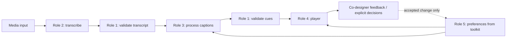

# CaptionFlow — Shared Contracts & Integration Hand-off

**Owner:** Role 1 (Brian) · **Base:** toolkit snapshot `9bb42e10ece3b7b0f2e6c2d1384e023d73e278b3` · **Status:** V1 integration contract; application-specific, **not** a toolkit protocol standard.

## Components



## 1. Input (`pipeline.run`)

```js
{ videoId: 'fictional-notice-001', media: { kind: 'fixture' } }
```

`media` is a host-supplied opaque object; each real transcriber must document supported kinds (`local-file`, approved remote URL, etc.). The bundled mock **only** accepts `kind:'fixture'`. Do not silently upload private video content to cloud services.

## 2. Timed transcription (`transcriber.transcribe({videoId,media})`)

```json
{
  "videoId": "fictional-notice-001",
  "sourceLanguage": "en",
  "segments": [
    {"id":"seg-001","start":0.5,"end":3.5,"text":"A community meeting will take place on Friday at 2:00 PM.","language":"en"}
  ]
}
```

Rules: `start/end` in seconds relative to video, `start >= 0`, `end > start`, source order by nondecreasing start, unique IDs, nonempty text, `en`/`sw`/`und` source language; specific segment language optional and inherited from source. Overlaps are allowed for simultaneous speakers if ordered. Empty speech is an explicit failure in V1. This is **not** a streaming contract. Actual ASR and alignment must be measured independently; valid timestamps are not proof they match the audio.

## 3. App caption preferences (`preferenceProvider.getPreferences({videoId,sourceLanguage})`)

```json
{ "captionLanguage":"en", "mode":"plain", "fontScale":1.3, "paceMode":"slow", "contrastMode":"high" }
```

- `captionLanguage`: `en|sw` (defaults to source language, or `en` when undetermined)
- `mode`: `original|plain` (default original)
- `fontScale`: 0.8–2.5 (default 1.0)
- `paceMode`: `normal|slow|manual` (default normal; player interprets the choice)
- `contrastMode`: `normal|high` (default normal)

These are **CaptionFlow host-level settings**. They are not guaranteed to be supported toolkit need dimensions. The Role 5 implementation should map supported AbilityModel settings and separately handle explicit host-specific fields; do not silently write invented dimensions to the core.

## 4. Processed captions (`captionProcessor.process({transcript,preferences})`)

```json
[
  { "id":"seg-001", "start":0.5, "end":3.5,
    "originalText":"A community meeting will take place on Friday at 2:00 PM.",
    "displayText":"There is a community meeting on Friday at 2:00 PM.",
    "language":"en", "mode":"plain", "status":"needs-review" }
]
```

V1 constraints: same cue count, IDs and order as source, source `start/end` **unchanged**, `originalText` exactly preserved. `language` identifies the displayed text's language, not the source automatically. `mode` identifies what was actually displayed, not just requested. Status values:

- `ready`: original source text presented as original without modification; never claim translated text as unchanged original.
- `needs-review`: mock/AI alternative needs verification; preserving important facts requires actual review.
- `fallback`: requested transformation unavailable; source text is shown and its source language retained.

**Future work:** merging/splitting captions or stretching their display boundaries requires a separate versioned contract and sync tests; do not alter timestamps in a caption simplifier silently. If language differs from the user's request on fallback, the player must surface the mismatch rather than label the text as translated.

## 5. Pipeline output / player input

```js
{ videoId, sourceLanguage, transcript, captions, preferences, warnings }
```

The player should render timed cues using `HTMLMediaElement.currentTime` (and ensure seek/pause/speed changes behave correctly). The player must treat `warnings` and non-ready caption statuses honestly; no automatic claim that AI translations are safe. Player code should consume this structure without coupling itself to the transcription or language-model provider. Note: the V1 mock includes **no playable video**.

## 6. Interface tests before PR to `dev`

- **Role 2:** valid ordered timestamps, language, provider unavailable, no-speech, invalid/missing video; test at least one real Kenyan English/Swahili sample where legally permitted.
- **Role 3:** source text retained, mode/language truthful, unchanged V1 times, missing transformation falls back, no unreviewed rewrite claimed factually safe.
- **Role 4:** cue selection by current video time, pause/seek/playback speed, keyboard and mobile UI, caption original/plain toggle, visible fallback/warning.
- **Role 5:** toolkit profile → settings mapping, explicit persisted changes, reversal/undo, no profile data transmitted to AI without informed approval.
- **Role 1:** mocks integrate without provider credentials; contracts reject invalid inputs; stage-specific errors; test command succeeds after integration.

Before merge: run `node --test captionflow/tests/*.test.mjs`, `npm test`, `npm --prefix server test` where appropriate, and document any known baseline `validate:browser` failure. PR **base** is `BrianOdhiambo/CaptionFlow:dev`, not the toolkit upstream main.

## 7. Cross-team policy

- Each owner publishes the *module interface* first; if a different shape is required, propose a contract change in the team chat/PR before coding incompatible data.
- No API keys or real personal data committed. Use permitted video samples only.
- Use the co-designer's preferences and accessibility feedback to choose actual pacing, size, language and interaction, rather than assuming KSL-first implies a specific written-language preference.