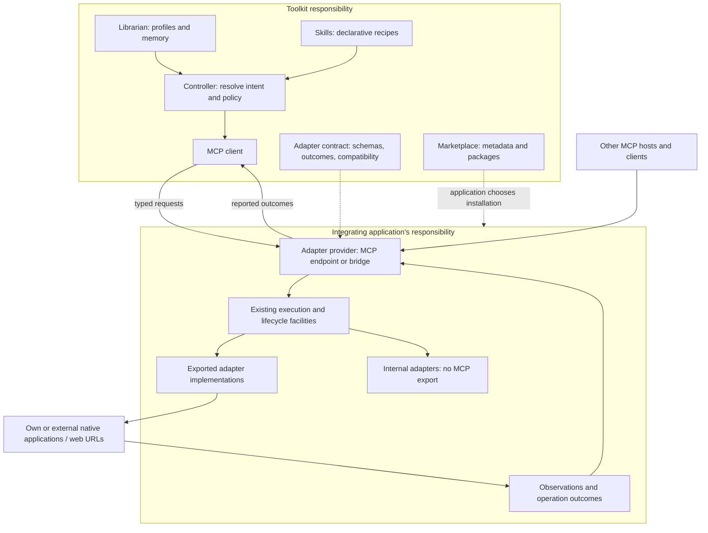

# Adapter architecture research

**Date:** 2026-10-15; ownership scope corrected 2026-10-16;
targeting synthesis updated 2026-10-17.
**Status:** architectural research and recommendations;
no runtime changes. Companion to [the Adapter MCP draft](adapter-mcp.md).
Runtime ownership and application/URL targeting are now clarified in that
proposal. Remaining recommendations identify revisions to validate before
stabilizing its wire contract.

## Conclusion

Define a shared adapter contract and an MCP binding that applications can
integrate with their existing execution facilities. The toolkit does not build
or manage those runtimes. Keep preference resolution, skill planning,
marketplace distribution, and application-owned execution distinct.
Applications own target access, permission checks, competing writes, resource
cleanup, and evidence about what actually happened. The contract describes the
operations and guarantees they expose without prescribing internal machinery.
The application containing an adapter may affect its own surfaces or external
native applications/web pages. The affected application need not expose MCP.

Accessibility personalization systems provide the closest domain precedent.
MCP provides interoperability; it does not supply the personalization model
or the semantics of restoring a setting.

## Scope and method

Studied primary specifications and project architecture documentation for
GPII, Fluid Infusion, MCP, LSP, W3C Web of Things, Home Assistant, Kubernetes,
and VS Code, with a subsequent targeting comparison against browser extensions
and W3C Web Annotation. Inspected the official MCP Python SDK's tool registration and
validation implementation and Home Assistant's entity cleanup implementation.
Compared those boundaries with this repository's draft, surface mapping,
skill resolution, and representative executable adapters.

MCP references use the draft's `2025-11-25` baseline, LSP references use 3.17,
and WoT references use the 1.1 Recommendations. Repository sources on `master`,
`dev`, or `v1.x` are moving references, not pinned release audits. This study
does not establish implementation performance or client compatibility; those
require the experiments at the end.

## 1. GPII: separate personalization decisions from applying settings

**Observed architecture.** The Flow Manager gathers preferences, available
solutions, and device information, coordinates matchmaking, then passes the
result to the Lifecycle Manager. Selection and execution have separate
owners. [GPII Flow Manager](https://github.com/GPII/universal/blob/master/documentation/FlowManager.md).

Solution descriptions declare platform contexts, settings handlers, launch
handlers, and lifecycle directives. Transformations map common preference
terms into application settings; inverse mappings are explicit or derived
where possible. Settings also declare whether changes take effect live or
require an application or OS restart. [Solutions registry format](https://github.com/GPII/universal/blob/master/documentation/SolutionsRegistryFormat.md).

The Lifecycle Manager retains session state, original configuration, and
performed changes. It serializes login/logout and start/stop/update work to
avoid races between asynchronous transitions. [Lifecycle Manager](https://github.com/GPII/universal/blob/master/documentation/LifecycleManager.md).

**Implication for us.** Preserve the chain:

```text
profile + context → resolve needs → choose available implementations
                 → translate parameters → execute locally → observe outcome
```

Our Librarian and skills should resolve intent; the application runtime should
execute it. An adapter description should explain both supported settings and
when their effects become observable. This matters beyond the browser: writing
a native preference may succeed before its application uses it.

**Limit.** GPII's desktop personalization sessions are not our universal
transaction model. Saving an original value does not prove it is safe to
restore after someone else edits it. Borrow the division of responsibilities
and explicit mappings; validate restoration independently.

## 2. Fluid Infusion: preference schemas, editor panels, and enactors

**Observed architecture.** The Preferences Framework provides schemas,
preference persistence, editor components, and an event-driven integration
API. Its architecture permits pluggable strategies that respond to preference
changes. [Preferences Framework](https://docs.fluidproject.org/infusion/development/PreferencesFramework).

An enactor is a component that implements a preference. A preference map binds
schema information into its model; model listeners trigger implementation
functions, such as changing CSS or starting speech. The preference's identity
is separate from its implementation. [Enactors](https://docs.fluidproject.org/infusion/development/Enactors).

**Implication for us.** The profile editor's pills, lists, and dropdowns should
edit typed preferences. Execution adapters consume resolved values. They should
not become responsible for profile storage or for inferring a user's needs.
Use explicit bindings from existing profile dimensions to concrete parameters
before introducing a new global capability vocabulary.

**Limit.** This is primarily an in-process web personalization framework. It
does not establish remote authorization, distributed retries, or native code
portability. Its model binding is useful even when we use a different runtime.

## 3. MCP: a typed interoperability boundary

**Observed architecture.** An MCP **host** is the coordinating client-side
application. It manages clients, permissions, consent, and context. Each client
connects to a server exposing capabilities. We reserve host for this client-side
role and use provider for the integrating application's exposed adapter interface.
[MCP architecture](https://modelcontextprotocol.io/specification/2025-11-25/architecture).

Tools publish input schemas and may publish output schemas. Discovery and
invocation already have standard operations. Domain failures can be returned
as tool results with `isError`; protocol errors are a separate mechanism.
[MCP tools](https://modelcontextprotocol.io/specification/2025-11-25/server/tools).

**Implementation evidence.** In the official Python SDK, `Tool.from_function`
derives the argument schema from function metadata, and `Tool.run` validates
arguments before invoking the function. `ToolManager` registers and dispatches
tools by name. This demonstrates a thin projection from registered operations
to MCP, rather than a second adapter execution framework.
[Tool implementation](https://raw.githubusercontent.com/modelcontextprotocol/python-sdk/v1.x/src/mcp/server/fastmcp/tools/base.py),
[ToolManager](https://raw.githubusercontent.com/modelcontextprotocol/python-sdk/v1.x/src/mcp/server/fastmcp/tools/tool_manager.py).

Tasks in this baseline are experimental and negotiated. They provide deferred
execution, status, result retrieval, and optional cancellation; tools declare
their task support. [MCP Tasks](https://modelcontextprotocol.io/specification/2025-11-25/basic/utilities/tasks).

**Implication for us.** Call the application's exposed interface an **adapter
provider**. This is a protocol role, not a runtime supplied by the toolkit.
Expose typed operations generated from the declared operation schema.
Prefer negotiated MCP Tasks for a later asynchronous binding. The first slice
can support bounded calls; long-running operations need an explicit supported
path before being exposed. Task cancellation and transport cancellation do
not establish that application effects were reversed.

**Tradeoff.** A generic `adapter_apply` is valid MCP and can reduce the number
of advertised tools. However, an unconstrained `parameters` object hides the
adapter's schema from ordinary tool consumers until a second discovery step.
Typed tools are our recommended default for a small installed catalog, not a
requirement of MCP. Compare both against a larger catalog before deciding on
an optional gateway.

## 4. LSP: the resource owner applies versioned changes

**Observed architecture.** A language server can request `workspace/applyEdit`,
but the client applies the edits and reports whether application succeeded,
with optional failure details. [Apply edit](https://raw.githubusercontent.com/microsoft/language-server-protocol/gh-pages/_specifications/lsp/3.17/workspace/applyEdit.md).

Workspace edits can address particular document versions. Clients advertise
supported resource operations and failure handling: abort, transactional,
text-only transactional, or best-effort undo. Atomicity is a declared
capability, not an inherent property of a multi-resource edit.
[Workspace edits](https://raw.githubusercontent.com/microsoft/language-server-protocol/gh-pages/_specifications/lsp/3.17/types/workspaceEdit.md).

**Implication for us.** Let the integrating application use its authorized
DOM/native APIs to enforce preconditions and commit changes. Adapters can use
document IDs, epochs, or native references to reject stale instances without a
universal target-handle format. Attach conflict checks to affected resources
where possible and declare partial application honestly. A successful preflight
check cannot reserve a target indefinitely; recheck at commit.

**Limit.** LSP's client/server direction follows editor ownership. In our design,
the application containing the adapter exposes MCP; an affected external
application may have no MCP interface. Borrow the explicit apply boundary
without copying LSP's topology or requiring ownership of the target runtime.

## 5. W3C Web of Things: distinguish state, actions, and observations

**Observed architecture.** WoT separates a Thing's implementation, its
description, runtime, and protocol bindings. Consumers use a software
abstraction over the exposed interaction surface. [WoT Architecture 1.1](https://www.w3.org/TR/wot-architecture11/).

Thing Descriptions distinguish properties, actions, and events. Schemas and
metadata describe those interactions; protocol forms bind them to concrete
endpoints. A common description therefore need not imply one implementation
language or transport. [Thing Description 1.1](https://www.w3.org/TR/wot-thing-description11/).

**Implication for us.** Separate persistent desired configuration, invoked
actions, and observations. Dark mode is state; generating an image description
is an action; target loss or an effective-setting change is an observation.
Share a small outcome envelope, but give operations their own result schemas.
Disabling a setting need not return the same payload as generating content.

**Limit.** WoT descriptions do not make arbitrary actions reversible. We can
borrow its interaction model without adopting its full vocabulary or bindings.

## 6. Home Assistant: command dispatch is separate from recorded state

**Observed architecture.** Core separates the service registry, state machine,
event bus, and timer. Integration data may arrive through polling or push;
entities publish state into the system. [Core architecture](https://developers.home-assistant.io/docs/architecture/core/),
[Fetching integration data](https://developers.home-assistant.io/docs/integration_fetching_data/).

**Implementation evidence.** Entity cleanup callbacks registered through
`async_on_remove` run both on aborted addition and normal removal. In source,
`add_to_platform_abort` and removal call `_call_on_remove_callbacks`. Cleanup
therefore covers resources allocated before activation succeeds.
[Entity implementation](https://raw.githubusercontent.com/home-assistant/core/dev/homeassistant/helpers/entity.py).

**Implication for us.** Distinguish requested state from observed state in the
outcome contract. Returning from `enable()` cannot itself verify visual effect.
Applications and adapter implementations own listener, observer, timer, and
overlay cleanup, including failed setup. The toolkit should not standardize
their cleanup machinery. Normal callers request an adaptation to stop; they
should not need a separate `dispose` call to prevent leaks.

**Limit.** Removing runtime resources and undoing persistent changes are
different responsibilities. Cleanup must remain possible even when restoration
conflicts or the original target has disappeared.

## 7. Kubernetes: reconcile owned intent and detect competing writers

**Observed architecture.** Controllers compare desired and current state and
act to reduce the difference. Controllers can divide responsibilities rather
than centralizing every behavior in one loop.
[Controllers](https://kubernetes.io/docs/concepts/architecture/controller/).

Server-side apply tracks field managers and detects conflicts when another
manager owns a field being changed. A field manager identifies a workflow;
it is not an authenticated security principal.
[Server-side apply](https://kubernetes.io/docs/reference/using-api/server-side-apply/).

**Implication for us.** Require providers offering undo or ongoing adaptation
to describe their conflict guarantees. Resource ownership and write generations
are possible application implementation techniques, not a toolkit controller
or storage requirement. Explicit user changes need a documented yield/conflict
policy. Ownership bookkeeping complements authorization and cannot replace it.

Consider undo: an adapter changes a value from A to B. The user changes B to C,
then deliberately chooses B again. Value equality now matches the adapter's
post-write value, but restoring A would erase a newer user choice. A generation
or ownership change can detect that history. This counterexample is our own
analysis of the draft's restoration guard.

**Limit.** External DOM or OS writes may not provide a reliable revision stream.
If ownership continuity cannot be established, report limited restoration
guarantees or decline undo. Kubernetes is inspiration for conflict accounting,
not a dependency or proof of universal safe undo.

## 8. VS Code: distribution, activation, and runtime compatibility

**Observed architecture.** A manifest declares identity, entry points, engine
compatibility, and contributions. Runtime activation binds executable behavior
to those declarations; deactivation and subscriptions support cleanup.
[Extension anatomy](https://code.visualstudio.com/api/get-started/extension-anatomy).

VS Code distinguishes local Node, browser, and remote extension hosts, with
placement influenced by extension kind and available implementations.
[Extension host](https://code.visualstudio.com/api/advanced-topics/extension-host).

**Implication for us.** Keep catalog listing, installed package, loaded
implementation, and currently executable operation distinct. A remote client
can use a common MCP interface while each platform runs its own implementation.
An MCP connection does not make browser JavaScript executable in a native app.

**Limit.** Runtime placement is not permission isolation. The provider must
still authorize operations; package metadata cannot grant its own privileges.

## 9. Targeting: match the outer resource, specialize internal references

**Observed architecture.** Browser extension match patterns describe eligible
URLs using scheme, host, and path components, including bounded wildcard
syntax. A pattern describes a set of resources; it is not a unique live tab or
document identity. [Chrome match patterns](https://developer.chrome.com/docs/extensions/develop/concepts/match-patterns).
Chrome's scripting API separately addresses live injection targets using a
tab ID and optional document or frame IDs.
[InjectionTarget](https://developer.chrome.com/docs/extensions/reference/api/scripting#type-InjectionTarget).

W3C Web Annotation models a specific resource using an outer source and an
optional selector, with several selector types for different media. It also
describes state information relevant to interpreting a changing resource.
[Specific resources](https://www.w3.org/TR/annotation-model/#specific-resources).

**Implication for us.** Use platform-scoped native application IDs and URL
patterns for compatibility/discovery. Keep native applications and web URLs as
peer target types. An invocation specifies one concrete outer target; its
optional `ref` is validated and interpreted according to the adapter's schema.
This avoids requiring a common addressing language for CSS elements, native
windows, document ranges, and XR objects. Matching and actual access are
separate, and duplicate tabs/windows require explicit disambiguation.

**Limit.** Neither precedent defines our native application identity vocabulary,
permission model, or execution protocol. Web Annotation selectors do not
themselves provide live UI control. Our array/wildcard grammar and platform
grouping are design choices requiring integration tests, not a standard derived
from these sources. Execution-platform support still belongs to the integrating
application; target-platform constraints describe what it can affect.

## Proposed architecture for this repository

This is a synthesis and recommendation, not the architecture prescribed by
any one source above. The toolkit defines the contract across the boundary;
the integrating application owns everything needed to execute it.



An application can also use the same schemas through an in-process API.
Optional binding helpers validate and delegate; they do not load adapters,
schedule work, own target registries, or retain undo journals. The provider may
wrap existing application functions without adopting a new framework.
The Librarian receives evidence only through the caller's normal authorized
memory flow.

Current repository seams worth preserving:

- [Skill resolution](../../toolkit/core/skill.js) returns settings, adapter IDs,
  and actions; it is not an executor.
- [Surface mapping](../../toolkit/core/surface.js) is pure: its `applied` map
  represents selected renderable values, not evidence that a live target was
  successfully changed. Preserve that distinction in runtime receipts.
- [DarkMode](../../tools/adapters/dark-mode.js) illustrates a stateful singleton
  with fallback behavior; a wrapper needs target-scoped instances or must
  explicitly restrict itself to one document.
- [Adapter exports](../../tools/adapters/index.js) expose implementations;
  exports alone are not a typed execution registry.

## Recommended changes to the original draft

| Draft area | Recommendation | Reason |
|---|---|---|
| Ownership (§1, §10) | Define the shared contract; applications own execution and lifecycle. | A common protocol does not require a toolkit-managed runtime. |
| Terminology (§1) | Use adapter provider for the application's exposed interface. | Reserve MCP host for its standard role; provider is a role, not a runtime framework. |
| Exposure and reach (§1) | Export selected adapters explicitly; distinguish internal/MCP visibility from self/external reach. | A self-only feature need not be exposed, and an external target needs no MCP endpoint. |
| Descriptor (§4) | One typed operation registration feeds validation, MCP schemas, and developer controls. | Prevent three contracts drifting apart. |
| Platform (§3–§4) | Applications declare supported and actual execution platforms; adapters inherit and may narrow support. Target rules separately constrain the affected OS. | Provider placement and target reach can differ; web/native are target types, not operating systems. |
| Queries (§5) | The application's MCP interface lists and queries its own adapters. Distinguish discovery, current-state readback, and preflight. | Adapters need no independent endpoint; a prior request or matching platform cannot establish current effective state. |
| Tool projection (§5) | Compare typed registered operations with the gateway; keep execution tracking and lifecycle helpers conditional. | Schema visibility is a design tradeoff, not an empirically established winner. Small providers need no mandatory job store. |
| Targeting (§6) | Match native applications or web URLs with platform-scoped rules; delegate internal references to adapter schemas. | Standardize the outer boundary without inventing universal window/element/XR addresses. |
| Target validity (§6) | Applications substantiate stale-reference and conflict guarantees using their own mechanisms. | Avoid prescribing a universal epoch, internal target registry, or write scheduler. |
| Results (§7) | Separate command acceptance, effective values, and verification; use operation-specific payloads. | Mapping or execution success is not proof of accessibility fulfillment. |
| Async handles (§8) | Defer mandatory job machinery; prefer an optional negotiated Tasks binding. | Avoid standardizing a second remote job lifecycle prematurely. |
| Undo (§8) | Advertise an actual guarantee per operation; applications choose how to enforce it. | Value equality cannot detect intervening choices; no shared journal is required. |
| Dispose (§8) | Leave resource cleanup to the application and adapter implementation. | Callers should not need lifecycle expertise to avoid leaks. |
| Capability vocabulary (§3) | Start with explicit mappings from existing dimensions, units, and bounds. | Prove cross-surface meaning before standardizing another ontology. |
| Skill composition (§9) | Give composition to the controller; report per-step outcomes and compensations. | A sequence of reversible steps is not an atomic transaction. |

Retain the draft's separation of marketplace and execution, explicit target
selection, minimal profile exposure, exact implementation identity, honest
partial outcomes, and distinction between cancellation and reversal.

## Integration experiments before stabilizing the contract

These validate interoperability with application-owned execution facilities;
they are not a plan to build a toolkit runtime. Optional guarantee tests apply
only to providers advertising the corresponding feature.

1. **One stateful adapter:** wrap DarkMode; exercise repeated configuration,
   fallback, user override, disable, failed setup, and document destruction.
   Demonstrate listener/style cleanup without a caller invoking dispose.
2. **One additive repair:** wrap an existing fix without inventing undo.
   Report changed, skipped, and unsupported items; preserve partial effects.
3. **One AI action:** wrap image description. Recheck the target before writing
   a delayed result. Test disconnect, cancellation, ambiguous completion, and
   retry without duplicate writes.
4. **Two competing writers:** reproduce the A→B→C→B undo case and unrelated
   target edits. Establish exactly which changes the provider can observe.
5. **Two surfaces:** map one profile dimension into web and XR/native settings,
   including units, range limits, and degradation. Do not infer equivalent
   readability from equivalent numeric values.
6. **Two client paths:** invoke the same registration directly and over MCP;
   compare validation and outcomes. Test a client without Tasks support.
7. **Catalog scale:** compare typed operations with gateway discovery for small
   and large catalogs using actual clients. Measure discovery cost and invalid
   calls before adding a generic gateway.
8. **Targeting and exposure:** test an internal self-only adapter and an exported
   external adapter; platform-specific application IDs; list/wildcard URL rules;
   duplicate tabs; and stale adapter-defined references after navigation. Check
   that matching scope never grants access, selects all instances, or makes
   internal adapters callable through a guessed ID.

These experiments should determine the minimum shared contract. The research
supports its boundaries; it does not settle the remaining wire shapes.
