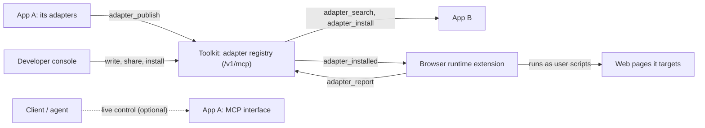

# Adapter MCP — draft application contract

**Status:** draft contract with a first implementation, updated 2026-10-29.
**Profile version:** `0.1.0`. Pre-alpha and not stable: the wire shapes can
still change, and two integrations so far have used them (the Redbird demo
store and the browser adapter runtime). In practice this means an app built on
it today may need changes later, and the adapters it shares have not been
tested with the people they are meant for.
[§13](#13-implementation-status-010) lists what is built and where;
[§14](#14-sharing-adapters-the-registry-packages-and-the-browser-runtime)
describes the adapter registry, the package format and the browser runtime.
The existing HTTP routes and adapter APIs keep working unchanged.

See [architecture research and recommended revisions](adapter-mcp-research.md)
for the review of relevant systems. This revision incorporates application/URL
targeting, platform-scoped matching rules, and adapter-defined internal references.
Wire shapes remain proposals to validate with real integrations.

“Adapter MCP” is a working name for an accessibility-adapter application
contract carried over standard Model Context Protocol tools. It is not an
official MCP extension or a replacement JSON-RPC protocol. The initial
interoperability baseline is MCP `2025-11-25`.

## 1. Purpose and boundaries

**Adapter MCP is how applications built with the toolkit, and the toolkit
itself, discover and share adapters.** An application that wrote an
accessibility adapter publishes it to its toolkit; another application finds
it and installs it, so a fix written once for one app can run in another. The
toolkit service is the MCP server that makes this possible: the **adapter
registry** at `/v1/mcp`, with tools to publish, search, share, install, and
report how running an adapter went (§14). An adapter that can travel carries a
**package**, code in a format a runtime knows (`web-module@1`, one JavaScript
file for web pages); one that cannot (XR, native code) is shared as a
description, so others can still find it and learn what it does.

To run shared web adapters anywhere on the web, the toolkit ships a reference
runtime: the **browser adapter runtime** extension (`extension/`). A developer
writes an adapter in the developer console, and the extension runs it on the
sites it targets, picks up each saved revision in open pages, and reports back
to the console. Other applications run what they install with their own code;
the SDK's `loadInstalledAdapters` helps a web app do that.

The same descriptions also let a client control an application's adapters
**live** while the application is open: discover them, learn exactly what input
they accept, query their state, check whether they can run on a particular
target, apply them, inspect the outcome, and request undo, through the same
contract across applications (§5–§8). This is optional. An application that
only shares adapters never needs to connect for live control.

An adapter implementation can remain JavaScript, Swift, Kotlin, or another
host-native implementation. A common interface does not make code portable;
a package format does, for the platforms that have one.

**Ownership boundary:** the toolkit defines the adapter contract, its MCP
binding, the registry, and the package format, and ships one reference runtime
(the browser extension) for web packages. It does not run an application's
own adapters: each integrating application keeps its execution environment,
lifecycle and permissions, and decides which shared adapters it installs and
how it runs them.

The contract separates these responsibilities:

| Component | Responsibility |
|---|---|
| Toolkit | Define shared adapter descriptions, schemas, package formats, outcome semantics and compatibility checks; host the adapter registry; ship the browser runtime and optional binding helpers. |
| Registry | Store each account's adapters and their revisions, keep them private until shared, record which app installed what, and collect runtime reports. Stores and serves code; never runs it. |
| Integrating application | Declare its identity and platform, publish the adapters it wants to share, install the ones it wants to use, and own installation, execution, target access, authorization, scheduling, cleanup and supported undo. Optionally expose adapters for live control. |
| Adapter | A module or feature within the application that implements an adaptation and reports concrete effects and limitations. It inherits the application's platform and may add narrower constraints. |
| Browser runtime | A reference application for web packages: runs what an account installed into `browser-runtime` on the pages each adapter targets. |
| Client | A developer UI, Controller, skill executor, or AI agent that discovers capabilities and requests work. |

The relationship is application → adapters. An adapter is not an independent
application, MCP server, or execution service. An application's MCP interface
exposes selected adapters for live control; **adapter provider** names that
interface's role, not a separate architectural component.

Exposure and reach are separate decisions:

| Field | Values | Meaning |
|---|---|---|
| `exposure` | `internal` (default), `mcp` | Whether the integrating application permits external discovery and live invocation of this adapter. |
| `reach` | `self`, `external` | Whether the adapter affects only the integrating application or can also affect other applications/web pages. |

An internal adapter needs no MCP wrapper. A self-only adapter can optionally be
exposed for coordinated personalization; an external adapter need not be exposed.
Only adapters explicitly exported by the integrating application are callable
through its MCP interface. A descriptor claiming `exposure: "mcp"` does not
itself register or authorize an export. `reach: "external"` describes
capability, not permission to control every application. Publishing an
adapter to the registry is separate again: it shares the adapter, and any
application that installs it runs its own copy.

Clients configure trusted provider connections explicitly; a registry entry or
listing never causes an automatic connection to its publisher. The registry
relays nothing: installing an adapter copies its package to the installing
application, which runs it.

In MCP terminology, the **host** is the coordinating client application.
Here, **integrating application** means the application containing the adapter,
and **provider** means its exposed adapter interface. The **target** is the native
application or web resource being affected; it may belong to another application
and needs no toolkit registration or MCP server. For example, the browser
runtime runs an adapter that changes a third-party website. The integrating
application performs changes through the APIs and permissions available to it;
it need not own the target application's runtime.



The toolkit standardizes the descriptions, packages, requests and outcomes.
Each integrating application decides how to resolve targets and execute its
adapters.

## 2. Decisions and precedents

| Decision | Inspiration |
|---|---|
| Use standard `initialize`, `tools/list`, and `tools/call`; publish input/output schemas. | [MCP lifecycle](https://modelcontextprotocol.io/specification/2025-11-25/basic/lifecycle) and [tools](https://modelcontextprotocol.io/specification/2025-11-25/server/tools). |
| Negotiate host features rather than assuming every application can do everything. | [LSP initialization and client/server capabilities](https://raw.githubusercontent.com/microsoft/language-server-protocol/gh-pages/_specifications/lsp/3.17/general/initialize.md). |
| Distinguish ongoing state from invoked actions and their outcome events. | [W3C WoT Thing Description 1.1](https://www.w3.org/TR/wot-thing-description11/), properties/actions/events. |
| Declare identity, implementation version, runtime requirements, and entry points separately. | [VS Code extension manifests](https://code.visualstudio.com/api/references/extension-manifest). |
| Match web resources with explicit URL patterns and alternative rules. | [Chrome extension match patterns](https://developer.chrome.com/docs/extensions/develop/concepts/match-patterns). |
| Separate the outer resource from a reference to something within it. | [W3C Web Annotation specific resources and selectors](https://www.w3.org/TR/annotation-model/#specific-resources). |

The tables and wire shapes below are this project's proposed application
contract. They are not requirements imposed by those source systems.

## 3. Identity, versions, and capability meaning

Keep these identifiers separate:

- **MCP version:** the date-based version negotiated through `initialize`.
- **Adapter profile version:** `ai4a11y.adapter-mcp` / `0.1.0`, advertised in
  `adapter_list` and descriptors. During `0.x`, clients require an explicitly
  supported exact profile version. A later `1.x` compatibility policy must be
  specified before relaxing this rule.
- **Implementation identity:** existing `appId/id`, plus an exact implementation
  `version` and host-computed `descriptorDigest`. Same-version descriptor/code
  changes invalidate the old digest. The digest pins content; it does not
  authenticate a publisher or establish trust.
- **Capability identity:** a versioned semantic identifier such as the proposed
  `a11y.text.scale@1`. The identifiers in this document are illustrative,
  project-defined names, not a published accessibility standard.

Capability definitions specify meaning, units, parameter/result schemas, and
what counts as fulfillment. They are independently versioned. Advertising
`supportAreas: ["vision"]` is discovery metadata, not an instruction to enable
an adaptation for everyone in that support area.

Profile dimensions, capabilities, and host settings are different concepts:
`textSize` need → `a11y.text.scale@1` capability → a web implementation's
`fontScale` setting. An XR implementation must declare a compatible semantic
mapping or a different capability; similar names do not establish equivalence.
Existing pure surface renderers perform these translations. The host evaluates
the actual result against the original need, including any `floor` constraint.

### Execution platform and adapter compatibility

Execution-platform metadata belongs to the integrating application. It declares
supported platforms and reports the actual platform of each connected instance. Its adapters
inherit that platform context and need not repeat it. `surfaces` describe what
an adapter can affect and remain distinct from the application's platform:

| Concept | Examples | Declared by |
|---|---|---|
| Application identity | `appId: "browser-extension"`, application version | Application/provider |
| Actual platform | OS `macos`, environment `browser-extension`, browser `chromium` | Connected application/provider |
| Supported platforms | Browser extension on Windows/macOS/Linux with Chromium or Firefox | Application's `supportedPlatforms` |
| Optional narrower constraints | A particular adapter is available only in the application's Android build | Adapter's `platformConstraints` |
| Target platform | OS `macos`, `windows`, `android`, or unrestricted `*` | Adapter's `targets[].platforms`; see §6. |
| Surface | `web`, `xr`, `native` | Surfaces the application can affect, adapter support, and actual target |

Illustrative connected-application advertisement:

```json
{
  "providerId": "provider-session-4",
  "application": {
    "appId": "browser-extension",
    "version": "1.0.0",
    "supportedPlatforms": [
      {
        "os": ["windows", "macos", "linux"],
        "environment": "browser-extension",
        "browser": ["chromium", "firefox"]
      }
    ],
    "platform": {
      "os": "macos",
      "environment": "browser-extension",
      "browser": "chromium"
    },
    "surfaces": ["web"]
  }
}
```

`appId` names an application family, not one running installation.
`providerId` distinguishes connected providers within the client's configured
connections; neither identifier grants execution authority. Each connection
advertises its actual platform independently. A native XR application and a
WebXR application can both affect an `xr` surface while using different
platform environments.

The application's `supportedPlatforms` is a nonempty array of alternative
compatibility records. Within a record, constraints are combined with AND;
entries in `os` or `browser` are alternatives. The advertisement above declares
the application's supported combinations once, for all its adapters.

An adapter may optionally declare `platformConstraints` using the same record
format to restrict its availability further. For example, an Android-only
adapter within a native XR application family could include this fragment:

```json
{
  "appId": "xr-guide",
  "id": "android-haptics",
  "platformConstraints": [
    { "os": ["android"], "environment": "native" }
  ],
  "surfaces": ["xr"]
}
```

Effective compatibility is the intersection of application support and any
adapter constraints. Omitting `platformConstraints` inherits application
support without additional restrictions; a present array must be nonempty.
Constraints cannot expand application support. An omitted dimension adds no
restriction; if a constrained dimension cannot be reported by the application,
compatibility is unknown rather than a successful match. Unknown platform
identifiers are not silently treated as compatible. Neither matching metadata
nor inheritance guarantees that an adapter is installed or available now.

This is environment metadata, not a runtime manager. Platform compatibility
narrows discovery; live target support, permissions, and dependencies are
checked separately. The connected application's actual platform is not part
of the static adapter descriptor digest.

`targets[].platforms` is a separate constraint on the **affected target's OS**.
It does not replace `supportedPlatforms` or `platformConstraints`, which describe
where the provider and adapter can execute. These may differ when an application
controls a remote device. `web` and `native` are target types/surfaces, not OS
identifiers. Matching a target rule cannot expand the integrating application's
actual reach or execution support.

## 4. Descriptor

Extend the marketplace's existing metadata rather than replacing it.
An executable descriptor has the following additional fields; conditional or
optional fields are identified explicitly:

| Field | Meaning |
|---|---|
| `adapterProtocol` | Application-contract name and version. |
| `version` | Exact implementation version. |
| `exposure`, `reach` | Internal/MCP export policy and self/external reach; see §1. |
| `mode` | `stateful` or `action`. |
| `capabilities` | Versioned capabilities, with an explicit binding to implementation parameters. |
| `platformConstraints` | Optional restrictions within the application's supported platforms. Omit to inherit; cannot expand application compatibility. |
| `surfaces` | Surfaces this adapter can affect. |
| `targets` | Nonempty list of supported target rules: platform constraints plus native application IDs and/or web URL patterns. Required for an exposed adapter; see §6. |
| `targetRefSchema` | Optional JSON Schema for the adapter-specific `target.ref`. Without it, a caller cannot supply `ref`. |
| `inputSchema`, `outputSchema` | JSON Schema 2020-12; inputs use explicit units, bounds, and required fields. |
| `stateSchema` | Required only when `query` is supported; describes readable state fields. Unobservable fields are omitted with explicit reasons. |
| `requires` | Requested host privileges, profile-read scopes, and named dependencies. |
| `effects` | Owned resources/settings, idempotency declaration, and reversibility claim. |
| `operations` | Supported domain operations; cancellation and revert are advertised explicitly. |

Example descriptor for a deliberately narrow web text-size implementation:

```json
{
  "appId": "browser-extension",
  "id": "text-scale",
  "name": "Text scale",
  "description": "Maintain a text-size multiplier on a web document or a selected region.",
  "version": "1.0.0",
  "adapterProtocol": { "name": "ai4a11y.adapter-mcp", "version": "0.1.0" },
  "exposure": "mcp",
  "reach": "external",
  "mode": "stateful",
  "capabilities": [
    { "id": "a11y.text.scale@1", "parameterBindings": { "scale": "scale" } }
  ],
  "surfaces": ["web"],
  "targets": [
    { "platforms": ["*"], "urls": ["*"] }
  ],
  "targetRefSchema": {
    "$schema": "https://json-schema.org/draft/2020-12/schema",
    "type": "object",
    "properties": {
      "documentId": { "type": "string", "minLength": 1 },
      "selector": { "type": "string", "minLength": 1 }
    },
    "additionalProperties": false
  },
  "inputSchema": {
    "$schema": "https://json-schema.org/draft/2020-12/schema",
    "type": "object",
    "properties": {
      "scale": {
        "type": "number", "minimum": 0.5, "maximum": 2,
        "description": "Unitless multiplier; 1.5 means 150 percent."
      }
    },
    "required": ["scale"],
    "additionalProperties": false
  },
  "outputSchema": {
    "$schema": "https://json-schema.org/draft/2020-12/schema",
    "type": "object",
    "properties": { "effectiveScale": { "type": "number" } },
    "required": ["effectiveScale"],
    "additionalProperties": false
  },
  "stateSchema": {
    "$schema": "https://json-schema.org/draft/2020-12/schema",
    "type": "object",
    "properties": {
      "enabled": { "type": "boolean" },
      "effectiveScale": {
        "type": "number",
        "description": "Observed text-size multiplier relative to the declared target baseline."
      }
    },
    "additionalProperties": false
  },
  "requires": {
    "host": ["web.document.style"], "profileScopes": [], "dependencies": []
  },
  "effects": {
    "writes": ["web.text-scale"],
    "idempotent": true,
    "reversibility": "full"
  },
  "operations": ["query", "check", "apply", "revert", "dispose"]
}
```

This descriptor belongs to the `browser-extension` application advertised
above. It omits `platformConstraints` and inherits that application's platform
support. Each adapter's `surfaces` must be within the application's declared
reachable surfaces; these need not be surfaces belonging to the application
itself. The broad URL rule is a compatibility claim, not evidence of current
access to every site. Actual target compatibility remains a separate check.
For this example, `documentId` identifies a live document within the resolved
URL, and `selector` narrows the adaptation to a region. Both are conventions
of this adapter, not mandatory fields for other adapters. Omitting `selector`
means the document root. Omitting `documentId` requires an unambiguous document.

The runtime computes `descriptorDigest` as `sha256:` followed by lowercase
hex SHA-256 of the UTF-8 [RFC 8785 JCS](https://www.rfc-editor.org/rfc/rfc8785)
serialization of `{descriptor, executionArtifactDigest}`. `descriptor` contains
the fields in the table plus `appId`, `id`, `name`, and `description`; timestamps,
ownership, availability, publishing links, and the digest itself are excluded.
`executionArtifactDigest` pins the installed package/native build; it is null
for metadata-only listings, which cannot execute. Both sides reject non-JCS
values and duplicate JSON object keys. Cross-language canonicalization and
digest test vectors are required before implementation.

Runtime availability is separate from this static descriptor. An installed
adapter may currently lack permission, a target, or an AI provider. A code blob
or metadata listing alone is never reported as installed and executable.

For profile reads, reuse the Librarian's existing closed grant scopes; a
manifest cannot introduce new grants. For most adapters, resolved parameters
are sufficient and `profileScopes` stays empty. Extend `requiresAI` with named
dependencies and optional fallbacks, rather than treating one boolean as proof
that every provider method is available.

## 5. MCP binding and discovery

Use ordinary MCP lifecycle and transport behavior. The provider advertises the
`tools` capability. The original gateway proposal below is a candidate binding;
each exposed tool has a JSON Schema input and structured output schema. Calls use
`tools/call`; `adapter_apply` is a tool name, not a new JSON-RPC method.

These tools are exposed by the integrating application's MCP interface. Listing
returns its explicitly exported adapters; state queries ask about one of those
adapters on an authorized target. An `adapterRef.appId` must match the connected
integrating application, not the affected native application or website.
Discovery across providers belongs to the marketplace or client aggregation of
configured connections. A target URL never specifies an MCP endpoint to connect
to. Execution-platform filters use the integrating application's metadata plus
adapter constraints; target filters use `targets` rules.

| Tool | Inputs | Output / behavior |
|---|---|---|
| `adapter_list` | Optional execution-platform/surface/capability and target-scope filters, plus opaque cursor. | Profile version, connected-application advertisement, exported and authorized adapter summaries, next cursor, and supported guarantees. |
| `adapter_describe` | Pinned adapter reference. | Full descriptor and current availability; exact parameters are described here. |
| `adapter_targets` | Pinned adapter reference, optional target-scope rules and cursor. | Authorized concrete application/URL candidates, with adapter-defined references where supported, next cursor, and enumeration coverage. Optional; no universal target registry is required. |
| `adapter_query` | Pinned adapter reference, target, and optional state field names. | Current readable state, observation time, evidence source, and unavailable fields; no adaptation is applied. |
| `adapter_check` | Adapter reference, target, and desired configuration. | Compatibility, dependencies, permission state, and potential degradation; no adaptation or AI call. |
| `adapter_apply` | Apply request below. | Accepted execution handle, or a terminal execution result. |
| `adapter_execution` | `executionId`. | Accepted/running state or the terminal result; ownership is rechecked. |
| `adapter_cancel` | `executionId`. | Request cooperative cancellation and report the current execution state. |
| `adapter_revert` | `receiptId`, optional supported preconditions and request key. | Guarded reversal of the original target recorded by the application; no retargeting by URL. |
| `adapter_dispose` | `instanceId`, optional supported preconditions and request key. | Cleanup of the original application-owned instance. |

This table does not require every application to implement every tool or a
toolkit runtime. The final binding must distinguish core operations from
optional execution tracking, cancellation, undo, and instance management.
Providers advertise supported tools and guarantees; clients cannot assume
unadvertised operations. Unsupported per-adapter operations return
`operation-unsupported`. Listing/description/target/query/check
tools are read-only. Mutation tools do not claim to be read-only, and undo
support must not be misrepresented by MCP's destructive/idempotent hints.

The gateway's apply schema defines the envelope and accepts `parameters` as
an object. It cannot statically describe every adapter's parameters. The provider
therefore MUST additionally validate against the pinned descriptor's
`inputSchema` and, when a reference is supplied, `targetRefSchema` before
execution. Per-adapter projected tools could expose these schemas directly.
That is a design option to compare with the gateway, not a conclusion proven
by the related-work review. The domain contract is shared by either binding;
the final tool projection remains open. Both delegate execution to
application-owned code.

The initial binding requires no MCP resources, sampling, elicitation, or
experimental Tasks support. Native hosts can use MCP stdio; network hosts can
use MCP Streamable HTTP. The existing Controller WebSocket envelope and hosted
REST routes remain separate interfaces, not MCP transports by renaming them.
An HTTP host implementing Adapter MCP must also implement the applicable MCP
HTTP authorization requirements; the current `aat_` REST token alone is not
evidence of conformance. Token audiences and execution authority stay distinct
from marketplace publishing credentials.

References: [MCP transports](https://modelcontextprotocol.io/specification/2025-11-25/basic/transports)
and [authorization](https://modelcontextprotocol.io/specification/2025-11-25/basic/authorization).

### Query semantics

Keep three questions separate:

- **Discovery:** which exported adapters can address this native application or
  web URL on this platform? Use list/describe, target rules, and execution
  compatibility. The marketplace can discover integrating applications and
  listed adapters; a connected provider can report live availability. Optional
  `adapter_targets` discovery can enumerate concrete target candidates.
- **State query:** what is currently enabled or effective on this target?
  Use `adapter_query`, or a typed per-adapter read operation in the projected
  binding. Reading state is optional and declared through `operations` and
  `stateSchema`; an adapter can support application without supporting readback.
- **Preflight:** could this particular requested change run now?
  Use `adapter_check` with the desired configuration. It is not current-state
  readback or a reservation.

Queries do not alter settings, enable an adapter, start an AI action, or write
profile memory. They read through the application's authorized APIs; the
toolkit supplies no polling service or shared state store. Providers must
authorize state reads just as they authorize access to the target.

Illustrative query arguments in the candidate gateway binding:

```json
{
  "adapterRef": {
    "appId": "browser-extension", "id": "text-scale", "version": "1.0.0",
    "descriptorDigest": "sha256:aaaaaaaaaaaaaaaaaaaaaaaaaaaaaaaaaaaaaaaaaaaaaaaaaaaaaaaaaaaaaaaa"
  },
  "target": {
    "platform": "macos",
    "url": "https://docs.example.org/article",
    "ref": { "documentId": "document-42", "selector": "main" }
  },
  "fields": ["enabled", "effectiveScale"]
}
```

Illustrative domain result:

```json
{
  "status": "ok",
  "target": {
    "platform": "macos",
    "url": "https://docs.example.org/article",
    "ref": { "documentId": "document-42", "selector": "main" }
  },
  "state": { "enabled": true, "effectiveScale": 1.5 },
  "observedAt": "2026-10-17T12:00:00Z",
  "cached": false,
  "consistency": "best-effort",
  "verification": "host-observed",
  "unavailableFields": []
}
```

The query's `state` conforms to `stateSchema`. Its status is `ok` when all
requested fields were observed, `partial` when only some were observable,
`unavailable` when none could be read, or `unsupported` when the operation is
not implemented. Omitting `fields` requests all fields declared by the state
schema. Unknown field names are validation errors. For supported fields that
cannot be read, omit the value and report `{field, code, message}` in
`unavailableFields`; never turn unknown into `false`, zero, or a default.
An action-only adapter can report unsupported readback rather than fabricating
an enabled state.

The observation time is when the state was actually read, not when a cached
reply was sent. `cached` identifies cached evidence, which retains its original
observation time. Last requested configuration is not observed effective state;
it may be a separately declared field but cannot substitute for readback.
Queries describe a snapshot, not a promise that state will remain unchanged.
Stale targets are rejected; `consistency` is `atomic` or `best-effort` for
multi-field reads. Providers expose a revision only when they can substantiate
it. The mutation statuses in §7 do not apply to read-only query results.

## 6. Targets and invocation

### Supported target rules

The shared contract resolves native applications and web URLs. Internal windows,
documents, elements, media sessions, and XR objects are interpreted by the
relevant adapter through `target.ref`; there is no universal internal address
format or mandatory toolkit-issued target handle.

An adapter's `targets` declaration is a list of alternative rules:

```json
{
  "targets": [
    {
      "platforms": ["macos"],
      "applications": ["com.example.reader", "com.example.editor"]
    },
    {
      "platforms": ["android"],
      "applications": ["org.example.reader"]
    },
    {
      "platforms": ["*"],
      "urls": ["https://docs.example.org/*", "https://*.example.com/*"]
    }
  ]
}
```

- `platforms` names target operating systems. It is required in each rule;
  `["*"]` adds no OS restriction within the provider's supported reach.
- `applications` contains native application identifiers, never display names.
  For example, a macOS bundle ID and an Android package name can be declared in
  separate platform rules. `["*"]` includes any native application the adapter
  supports. Partial application-ID globs are not part of the initial contract.
- `urls` contains web URL patterns. `["*"]` includes HTTP(S) web resources the
  adapter supports. It does not include browser-internal pages, local files, or
  arbitrary schemes. URL syntax follows a defined subset of browser match
  patterns: HTTP/HTTPS or `*` scheme, exact/`*`/`*.domain` host, and `*` path
  wildcards. A wildcard scheme matches HTTP and HTTPS; `*.example.com` includes
  the domain itself and its subdomains. Query and fragment constraints are not
  expressed by these scope patterns; exact invocation URLs retain both.
- Every present list must be nonempty. A whole-field `*` must be the sole list
  item. At least one of `applications` or `urls` must be present. Omission of a
  target type excludes it from that rule, rather than matching everything.
- Rules are OR alternatives. Within a rule the platform must match, and either
  the native application or the web URL must match. `applications` and `urls`
  are peers and may coexist in a rule; they are not parent/child identifiers.
  Constrained but unknown platform facts do not count as a match.

These are supported-scope declarations, not permission grants or instructions
to apply changes to every match. `reach: "self"` additionally restricts matches
to the integrating application's own surfaces, even if its rules are broad.
Application-ID namespaces and URL normalization/port behavior need fixtures
before the draft matching grammar can be frozen.

The optional `adapter_targets` operation accepts scope rules to find live
candidates. Each candidate contains a concrete `target` and may have a display
label. Any internal reference it returns must conform to the pinned adapter's
`targetRefSchema`. Its result includes `nextCursor` and
`coverage: "complete" | "partial" | "unknown"`, relative to the requested,
authorized scope. An incomplete enumeration cannot establish that no target
exists. The operation reads the application's available facilities; it does
not require the toolkit to track running applications or browser tabs.

### Concrete target and adapter-defined reference

An invocation uses **exactly one** of `target.application` and `target.url`:

```json
{
  "target": {
    "platform": "macos",
    "application": "com.example.reader",
    "ref": { "windowId": "window-7", "page": 3 }
  }
}
```

This native reference is illustrative and would be defined by that native
adapter's schema. A web adapter might instead accept the document ID and CSS
selector shown in the apply example below. Reference fields can differ across
adapters and target types; the descriptor must explain their meaning and scope.
If no `targetRefSchema` is declared, supplying `ref` is invalid. Omitting `ref`
addresses the adapter's documented application/resource scope. A required
subresource must be supplied explicitly, not guessed.

`platform` is required for native identifiers to establish their OS context.
For a URL it is an optional OS constraint; the provider resolves actual target
facts and checks the descriptor's rules in either case. A caller's platform
claim is never sufficient evidence of compatibility. A native browser UI uses
`application`; a page inside it uses `url`.

Lists and wildcard matching belong to discovery and supported-scope rules.
The initial apply/query/check contract operates on one concrete target per
request; it has no implicit apply-all behavior. A URL alone may resolve to
several tabs, documents, or devices. Without a reference that resolves the
ambiguity, return `target-ambiguous` and allow the client to select a candidate.
Do not silently choose the active window or every match. Persisted URL matching
policies and bulk operations would be separate, explicitly advertised features.

Resolution follows this boundary:

```text
client selects provider + adapter
  → provider matches the native application or web URL and target platform
  → adapter validates/interprets its internal reference
  → provider checks access and adapter applies the requested operation
```

The reference must stay within the resolved outer application/URL and must not
redirect execution to another target or endpoint. References are data, never
arbitrary code evaluated by the shared protocol. If the provider cannot enforce
that boundary or resolve the target uniquely, it returns an explicit failure.
Access is checked on every read and mutation.

An application ID or URL is a locator, not a stable live-instance identity.
Applications/adapters own any document IDs, native handles, epochs, or revisions
needed to reject stale references and revalidate after asynchronous work. Such
details can be carried in `ref`; their format and lifetime are adapter-defined.
Saved recipes retain durable locators and resolve fresh live references rather
than assuming a prior tab/window still exists. `expectedRevision` is optional
and only supported when the provider advertises reliable revision checking;
unsupported preconditions are rejected, never ignored. No universal epoch or
revision counter is required. Undo receipts must still identify the original
affected instance and must not resolve a replacement document from its old URL.

### Apply request

An `adapterRef` contains `{appId, id, version, descriptorDigest}`. A client pins
the exact descriptor it checked, rather than invoking whatever now has the
same display name.

```json
{
  "jsonrpc": "2.0",
  "id": 12,
  "method": "tools/call",
  "params": {
    "name": "adapter_apply",
    "arguments": {
      "profileVersion": "0.1.0",
      "adapterRef": {
        "appId": "browser-extension", "id": "text-scale", "version": "1.0.0",
        "descriptorDigest": "sha256:aaaaaaaaaaaaaaaaaaaaaaaaaaaaaaaaaaaaaaaaaaaaaaaaaaaaaaaaaaaaaaaa"
      },
      "target": {
        "platform": "macos",
        "url": "https://docs.example.org/article",
        "ref": { "documentId": "document-42", "selector": "main" }
      },
      "expectedRevision": "revision-8",
      "desired": { "enabled": true, "parameters": { "scale": 1.5 } },
      "requestKey": "request-unique-to-this-intent"
    }
  }
}
```

This example assumes the connected provider advertises revision checking and
previously observed `revision-8`. Providers without that guarantee omit
`expectedRevision` from supported requests; clients cannot invent one.

For `stateful` adapters, `desired` is a complete desired configuration, not a
merge patch. Explicit `false`, `0`, empty strings, and enum off-values remain
values. `enabled: false` removes this instance's owned ongoing adaptation;
it does not erase earlier independent action effects or somebody else's
settings. Parameters are required and schema-validated when enabled; when
disabled they must be omitted. The runtime returns its effective inactive
state and any resources it could not release.

For `action` adapters, `desired` contains `parameters` only; `enabled` is not
accepted. Pure transformations fit this mode with an empty write set. Starting
an ongoing caption/voice stream fits stateful mode instead.

Stateful instance scope and conflict behavior must be declared by the provider.
One instance per principal, adapter implementation, and resolved live target is a
possible integration policy, not a toolkit-managed registry. The application
owns coordination and validates permissions, implementation identity, and
target preconditions before effects. The contract must report conflicts and
stale targets without prescribing locks, queues, or reconciliation loops.
`adapter_check` is advisory, not a reservation or permission.

## 7. Results, availability, and evidence

In the candidate tracked-execution binding, every execution has an opaque
`executionId` and one terminal result. Providers exposing instance management
also return an `instanceId`; synchronous-only providers need no retained
execution or instance registry. The provider stamps adapter reference, target,
authenticated actor, origin of the request, timestamps, and resulting target
revision when supported. The result identifies the resolved concrete target,
including any supported reference needed to distinguish live instances.
Adapter-specific `data` conforms to `outputSchema` when present. `applied` and
`noop` results include conforming
`data`; failure/unavailable results may omit it. Each result accounts for
effects even on failure. A completed apply execution can leave a stateful
instance active; operation completion is separate from instance lifetime.

```json
{
  "executionId": "execution-9",
  "instanceId": "instance-3",
  "operation": "apply",
  "status": "applied",
  "adapterRef": {
    "appId": "browser-extension", "id": "text-scale", "version": "1.0.0",
    "descriptorDigest": "sha256:aaaaaaaaaaaaaaaaaaaaaaaaaaaaaaaaaaaaaaaaaaaaaaaaaaaaaaaaaaaaaaaa"
  },
  "target": {
    "platform": "macos",
    "url": "https://docs.example.org/article",
    "ref": { "documentId": "document-42", "selector": "main" }
  },
  "targetRevision": "revision-9",
  "effectsKnown": true,
  "requested": { "scale": 1.5 },
  "applied": { "fontScale": 150 },
  "unmet": [],
  "degradedTo": {},
  "data": { "effectiveScale": 1.5 },
  "verification": "host-observed",
  "undo": { "available": true, "receiptId": "receipt-9", "scope": "original-document" },
  "reasons": []
}
```

The enclosing MCP `CallToolResult` puts this object in `structuredContent`
and includes a text representation for compatibility. `content` and `isError`
are MCP fields; the object above is the domain result, not a JSON-RPC envelope.

| Terminal status | Meaning |
|---|---|
| `applied` | Requested adaptation executed; inspect verification and effective values. |
| `partial` | Some effects landed but some requested outcome remains unmet. |
| `noop` | Desired state already held, or an action had nothing to change. |
| `unavailable` | No effects: capability, dependency, target, or permission prevented execution. |
| `failed` | Execution failed; effects may be absent, partial, or unknown. |
| `cancelled` | Work stopped following cancellation; earlier effects may remain. |

Reason objects have `{code, message, key?}`. Initial codes include
`invalid-parameters`, `permission-required`, `permission-denied`,
`missing-provider`, `target-unavailable`, `target-ambiguous`, `invalid-target-ref`,
`target-out-of-scope`, `stale-target`, `stale-revision`, `precondition-unsupported`,
`descriptor-changed`, `unsupported-setting`, `out-of-range`, `write-conflict`,
`operation-unsupported`, `undo-expired`, `instance-active`, and `internal-error`.
Messages are accessible plain text; code/structured values drive decisions.

Malformed JSON-RPC and unknown MCP tools use MCP protocol errors. A known
gateway tool's domain validation/access/execution failure is a tool error
with structured reasons, not a transport disconnect. For mutations, terminal
`applied`/`noop` use `isError: false`; other terminal statuses use `isError: true`.
A successful check that finds an unavailable adapter still uses
`isError: false`: the check itself succeeded and its `compatible: false`
explains the finding. Do not automatically retry partial failures.

`verification` is `adapter-reported`, `host-observed`, or `user-confirmed`.
These describe evidence for the adaptation, not proof of accessibility or
clinical effectiveness. Pure surface projection must not emit a successful
execution receipt. The client evaluates effective outcomes against the
original need; a value degraded below a required floor remains unmet even if
the surface supports that fallback.

## 8. Optional execution guarantees and application-owned lifecycle

The mechanisms in this section are candidate provider extensions, not services
the toolkit operates. A provider may expose synchronous operations without a
job store or undo journal. It must advertise which guarantees it implements;
clients cannot infer deduplication, cancellation, or reversibility from MCP
connectivity alone.

For a provider advertising deduplication, the same principal/provider/operation
and request key with the same canonical arguments returns the same execution;
the same key with different arguments is rejected. The provider declares the
retention window; no toolkit retention service or mandatory 24-hour journal
is implied.
Reconnecting does not change principal identity. After expiry, clients must
inspect state or obtain user intent before retrying non-idempotent actions.
An ambiguous crash must never trigger an automatic replay of a non-idempotent
action. Recovery reports `failed` with `effectsKnown: false` if effects cannot
be determined. This is not a promise of distributed exactly-once execution.

Synchronous operations return their outcome directly. A provider implementing
the candidate custom execution-handle extension could return:

```json
{
  "status": "accepted",
  "executionId": "execution-9",
  "pollAfterMs": 500,
  "expiresAt": "2026-10-17T12:00:00Z"
}
```

Polling `adapter_execution` returns `accepted`, `running`, or a terminal
result; these are application states. Accepted/running responses use
`isError: false`, which acknowledges submission, not completion. Authorization
precedes even execution existence disclosure. Expired handles return a stable
error; the host never fabricates success after losing state.

MCP request cancellation cancels an RPC wait and does not establish the
final effect state. Once a handle exists, clients use `adapter_cancel` and
poll the same execution until terminal. Cancellation is cooperative; if the
adapter cannot stop yet, report running/cancellation requested, not cancelled.
Disconnected clients do not implicitly revoke an ongoing adaptation. The
runtime applies bounded execution deadlines, exposes retention/lease expiry,
and attempts cleanup on target destruction or permission revocation.

The custom execution handles above were the original proposal. The related-work
review suggests evaluating a negotiated MCP Tasks binding before standardizing them.
Neither option requires the toolkit to own the application's job lifecycle.
References: [MCP cancellation](https://modelcontextprotocol.io/specification/2025-11-25/basic/utilities/cancellation)
and [experimental Tasks](https://modelcontextprotocol.io/specification/2025-11-25/basic/utilities/tasks).

If undo is offered, a receipt is an opaque application-issued reference,
scoped to the authorized operation and target. It may refer to the application's
native undo mechanism; the contract does not prescribe a journal layout or
storage service. It is not a caller-supplied inverse script. The application
must honor its declared conflict guarantees and avoid overwriting later user
or adapter changes. Comparing values alone cannot detect intervening choices;
see the research's A→B→C→B counterexample. Conflicting or expired receipts have
explicit partial/unavailable outcomes. Reversal cannot address a replacement
target. Repeating a completed reversal is a no-op, not another inverse
operation. Its result reports reversed and remaining effects;
`operation: "revert"` prevents interpreting them as new adaptations.

`effects.reversibility` is a claim (`full`, `partial`, `none`); the receipt's
`undo.available` describes this particular execution. Additive legacy fixes
without a journal must say undo is unavailable. Failed/cancelled executions
still offer undo if known partial writes were journaled. All-or-nothing
multi-adapter transactions are not promised.

Resource cleanup belongs to the integrating application and adapter
implementation. A separate `adapter_dispose` tool is not a core requirement.
If an application exposes it, it must define instance scope and idempotency;
disposal cannot silently stand in for undo. Target loss may prevent restoration
while still requiring application-owned listeners or resources to be released.

## 9. Policy, privacy, and skill composition

Registration, code installation, permission to read profile data, and permission
to mutate a target are distinct authorities. The runtime enforces policy;
`adapter_check` and manifest claims cannot grant it. Host-approved ongoing
adaptation can use previously granted policy without prompting on every
reconciliation. New privileges, code identity changes, or irreversible work
must follow the host's explicit consent policy.

Third-party descriptions, output text, and document content are untrusted data.
Adapters get resolved parameters and the smallest authorized context, never
unrestricted access to the Librarian or its memory database. Requested host
privileges are meaningful only when enforced by the runtime's execution
boundary. For initial wrappers, in-process execution is for trusted bundled
code. Downloaded code requires a separately defined isolated execution model
or an explicit trusted-code installation decision; a denylist is not a sandbox.

The host may send outcome observations to `logObservation`, respecting its
pause/no-memory rules and data limits. It records trusted provenance separately:
user-explicit action, profile-derived adaptation, skill execution, or agent
request. A client-provided string cannot promote itself to user-explicit
authority. Automatic execution is not evidence of a new preference. Adapter
output can suggest an insight; only existing Librarian methods and their
consent/grant gates can change the profile.

Skills remain recipes, not executable adapters. Existing skill recipes still
resolve pinned/local adapter IDs. A later recipe version may request a
capability with constraints and approved fallbacks. The host resolves a concrete
implementation, checks all prerequisites, and applies steps in a defined order.
Partial failure reports per-step receipts. It never claims transactionality or
unconditionally rolls back later user changes. Existing `ControlPort` can
delegate individual operations to the runtime; its own wire contract remains
unchanged during migration.

## 10. Contract development and integration examples

1. **Schemas and fixtures:** formalize descriptors, target matching rules,
   concrete target envelopes and adapter-defined reference schemas, typed
   operation inputs and outcomes, compatibility declarations, and errors.
   Separate optional execution/undo extensions from the core.
   Keep draft schemas/examples under this design until implementation lands;
   promote checked wire contracts into `toolkit/protocol/adapter/` then.
2. **Binding helpers:** optionally share schema validation and MCP projection
   helpers. They delegate to application-owned functions; they do not provide
   a scheduler, target registry, plugin loader, job service, or undo journal.
3. **Three integration examples:** dark mode (ongoing state), a content repair (one-shot,
   honest undo limitations), and image description (provider dependency and
   cancellation/partial-result behavior). A wrapper around `enable()` must
   implement configuration updates, not assume another enable changes options.
4. **MCP integration:** let one application expose its existing adapter
   operations. Demonstrate the contract with its own authorization and
   lifecycle facilities, including self and external targets and adapters kept
   internal; do not require adoption of a new runtime framework.
5. **Marketplace/UI:** retain current `data`/`code` meanings; add an explicit
   optional protocol descriptor reference/digest and compatibility status.
   Legacy listings remain discoverable but are labeled legacy/metadata-only
   until an application supplies a compatible executable implementation. The current
   manifest validator drops undeclared fields; update storage/validation before
   asking publishers to send new ones.
6. **Second integration:** validate one native/XR application against the fixtures before
   declaring `1.0`. This tests that the contract does not depend on DOM globals.

Module ownership: `toolkit/protocol/adapter/` for schemas and fixtures;
optional binding helpers in `toolkit/adapter-mcp/`, separate from
application-specific execution code. Application owners choose where their MCP
endpoints and execution facilities live. New cross-package edges follow the
repository's package-boundary review/test rules.

## 11. Acceptance criteria

- MCP initialization/list/call work with a general MCP client; no custom RPC
  methods are required. Tool inputs and structured outputs validate.
- Descriptor/profile-version mismatches and unsupported host features are
  visible failures before mutation. Local and MCP calls have equivalent effects.
- Execution-platform support is declared once by the application and inherited
  by its adapters. Optional adapter constraints can narrow support but cannot expand
  it. Discovery distinguishes that support, the connected application's actual
  platform, target-platform rules, and affected surfaces. Missing platform facts
  do not imply compatibility, and a match does not grant execution permission.
- The application's MCP interface exposes only explicitly exported adapters it
  owns and validates the provider namespace on queries and mutations. Internal
  adapters cannot be invoked by guessing an ID. The affected application may
  differ from the provider and needs no MCP endpoint or toolkit registration.
- Rule matching preserves platform AND (native application OR web URL), with OR
  between rules. Empty lists, malformed patterns, mixed whole-field wildcards,
  unknown application-ID forms, and missing target types are validated.
- Wildcards scope discovery; apply never silently fans out. Duplicate URLs or
  application instances require adapter-defined disambiguation. An internal
  reference cannot escape the resolved application/URL or bypass `reach: "self"`.
- Target references validate against the selected adapter's schema. Stale live
  references and unsupported revision preconditions fail explicitly. No universal
  selector, epoch, or toolkit target registry is required; undo cannot retarget
  a replacement instance at the same URL.
- State queries are read-only and schema-validated. Unsupported, unobservable,
  stale, and cached state cannot masquerade as a currently disabled adapter
  or as verified effective configuration.
- All input falsy values survive serialization; units are never guessed.
- Stateful enable/update/disable and target replacement have defined outcomes.
  Providers claiming retry deduplication demonstrate their declared guarantee.
- Missing AI/provider permission is distinguishable from nothing-to-change.
- Partial failures account for known/unknown effects. Cancellation and crash
  recovery behavior are checked where those extensions are advertised.
- Undo, when offered, honors its declared scope and refuses to overwrite a
  later user change; unsupported undo remains explicit.
- Other principals cannot inspect executions/receipts/targets or use guessed
  handles. Marketplace ownership alone does not authorize host execution.
- Unknown capability identifiers remain discoverable but cannot silently run.
- A skill can report a partially applied plan with per-step receipts.
- Automatic outcomes never become user-explicit preference records.
- UI controls can be generated from schemas while custom values outside a
  closed enum are permitted only where the adapter's schema allows them.

## 12. Decisions to validate before stabilizing

Runtime ownership is settled: each integrating application owns its execution
environment, and the toolkit's browser runtime is one such application for web
packages. Before calling the profile stable, validate these choices with
two independently managed application integrations:

- Fixed gateway tools versus additionally exposing per-adapter typed tools.
- Platform-specific native application-ID namespaces and the portable URL
  matching grammar, including normalization and ports. Validate duplicate-tab,
  embedded-web, and remote-target cases without adding a universal internal
  reference language. Browser/device selection belongs in adapter schemas when needed.
- The initial capability dictionary and who approves semantic/version changes.
- Whether application execution handles remain sufficient or negotiated MCP
  Tasks materially improve interoperability for AI/media operations.
- The minimum observable undo guarantees across applications with different
  internal storage and restart behavior; no shared journal implementation.
- How applications report compatibility with downloaded code. Installation
  and isolation remain application-owned; the registry's lint is not a sandbox.
- The `web-module@1` package format: a line-based export rewrite, one file, no
  imports. Validate it against adapters written by people other than its
  authors before adding a second format.
- Sharing scope: today a shared adapter is visible to every account on the
  toolkit instance. Groups (a workshop table, a team) may be needed.

Related current interfaces: [adapter listings](../ADAPTER-MARKETPLACE.md),
[hosted wire contract](../../server/CONTRACT.md),
[Controller protocol](../../controller/PROTOCOL.md),
[surface contract](../../toolkit/core/surface.js), and
[catalog conformance tests](../../tools/test/adapter-conformance-test.js).

## 13. Implementation status (0.1.0)

What exists now, so the sections above can be read against working code.

| Part | Where | What it does |
|---|---|---|
| Wire contract | `toolkit/protocol/adapter/` | Descriptor and application checks, the URL/target matching grammar, the JSON Schema subset validator (it rejects unsupported keywords rather than ignoring them), RFC 8785 canonical JSON and descriptor digests, the gateway tools' input and output schemas, and shared fixtures (`fixtures/`). No dependencies; runs in a browser or Node. |
| Provider and helpers | `toolkit/adapter-mcp/` | `createAdapterProvider` (an MCP server for one application's exported adapters, as a JSON-RPC handler), `fromToggleAdapter` / `fromAction` (wrap existing adapters), `connectToToolkit` (connect a provider to a toolkit service), `createMcpClient` / `adapterClient` (a small client), and `catalogDescriptors` (descriptors for the built-in catalog). |
| Toolkit service | `server/src/providers.js`, `server/src/relay.js` | Relays MCP requests to connected apps, so an app in a browser tab is reachable at `/v1/mcp/apps/{appId}` or `/v1/mcp/providers/{providerId}` without opening a port. Lists the account's apps for the developer console. See [the hosted contract](../../server/CONTRACT.md#adapter-mcp-apps). |
| Packages and registry wire | `toolkit/protocol/adapter/package.js`, `registry.js` | The `web-module@1` format (export rewrite, adapter pick, lint, package checks, artifact digest), URL patterns as Chrome match patterns and exact regular expressions, and the registry tools' input schemas. |
| Registry | `server/src/registry.js` | The toolkit's MCP server at `/v1/mcp` (§14): per-account adapters and revisions, the shared index, installs, runtime reports, resources and change notifications. |
| Registry client | `toolkit/adapter-mcp/registry.js` | `createRegistryClient` (publish, search, share, install, installed, report, status, watch) and `loadInstalledAdapters`. |
| Browser runtime | `extension/` | The reference runtime for web packages (§14.4). |
| Developer console | `server/developer/adapters.js` | The Adapters page: write an adapter with live lint, save revisions, run it in the browser runtime, share it, install others' and see the runtime's reports. |
| Listings | `server/src/adapters.js` | The older marketplace of descriptions. A listing may carry a `descriptor`; the service checks it and computes its digest. Listings without one are shown as legacy. |
| Integration | the Redbird demo store (`workshop/toolkit.js` in its repository) | Exports the workshop adapters (and, from a starter folder, the participant's own `adapter.js`) as the app `redbird` for live control, keeps the rest of its library internal, and limits each tab to its own page. |

Decisions the implementation took for 0.1.0, to revisit with a second,
independently built integration (§12):

- **Gateway and typed tools.** Both: the seven `adapter_*` gateway tools, plus
  one `apply_<id>` shortcut per exported adapter (an application can turn the
  shortcuts off). Shortcuts take `{enabled, parameters?, target?, requestKey?}`, with the
  adapter's own parameter schema inlined under `parameters` and no `adapterRef`
  (they always mean the adapter currently exported), and resolve
  the target only when there is exactly one complete candidate.
- **No execution handles.** Every operation is synchronous; `accepted` and
  `adapter_execution` / `adapter_cancel` are not implemented. Long AI operations
  are bounded by the relay's 30-second request timeout for now.
- **Retries.** `requestKey` deduplicates a repeated apply within a window
  (10 minutes by default) per provider instance; it is not kept across restarts.
- **Undo.** Opaque receipts. `fromToggleAdapter` keeps a generation counter
  for each wrapped adapter and also checks the adapter's own on/off state, so
  undo refuses with `write-conflict` after any later change, including one made
  outside MCP or one that returns to an earlier value (A→B→C→B).
- **URL ports.** A pattern without a port matches any port, so one rule covers
  `localhost` on whatever port a workshop uses.
- **Identity of the code.** Descriptors may carry `executionArtifactDigest`
  (for example the hash of a participant's `adapter.js`), which is part of the
  descriptor digest, so a pinned `adapterRef` stops matching when the code changes.
- **Authorization.** The toolkit service authorizes with its own bearer tokens
  (an account's default token or an app token), and only the same account can
  reach an app. This is not MCP's OAuth authorization flow.
- **Scale.** The relay is in memory in one process: it does not survive a
  restart and does not span several service instances. Apps reconnect on
  their own after a restart.

## 14. Sharing adapters: the registry, packages and the browser runtime

### 14.1 The registry

The toolkit service is an MCP server at `/v1/mcp` (Streamable HTTP: `POST`
for JSON-RPC, `GET` with `Accept: text/event-stream` for notifications). Any
token of an account reaches it, and everything it answers is scoped to that
account plus what other accounts shared.

| Tool | Does |
|---|---|
| `adapter_publish` | Publish a descriptor, with an optional package, as a new revision. The registry checks both, computes `executionArtifactDigest` (SHA-256 of the code) and `descriptorDigest`, and does not make a new revision when nothing changed. Private unless `shared: true`. A descriptor without `adapterProtocol` is a short one: the registry fills the rest with `defineDescriptor`'s defaults. |
| `adapter_share` | The owner shares an adapter with every account on this toolkit, or stops sharing it. |
| `adapter_search` | The caller's adapters and the shared ones, filtered by words, app, URL, support area, or portability; each with where it is installed. |
| `adapter_get` | The descriptor and package at the latest or a kept revision (the newest 20 are kept). |
| `adapter_delete` | The owner deletes an adapter and its revisions. |
| `adapter_install` / `adapter_uninstall` | Install an adapter into one of the account's apps, or change an installation: the revision (`"latest"` or a number), switched on or off, off on particular sites (origins), and `enable(options)` parameters checked against the descriptor's `inputSchema`. |
| `adapter_installed` | What an app installed, resolved to revisions, with packages on request and an etag, so an unchanged answer is cheap. |
| `adapter_report` / `adapter_status` | A runtime reports what happened per adapter and page origin (`applied`, `failed` with the error, `skipped`, `removed`); the console reads them back. |

An adapter is named `{owner, appId, id}`: the owning account's uid, the
publishing application, and the adapter id, so many workshop participants can
each publish `redbird/my-adapter`. Adapters are also MCP resources
(`adapter://owner/appId/id`, `resources/list` and `resources/read`). The
notification stream sends `notifications/resources/list_changed`, with the
reason in `params._meta["ai4a11y/registry"]`, whenever an adapter the account
can see changes, its installs change, or one of its runtimes reports.

**Revisions and trust.** Installing your own adapter follows the latest
revision, so a saved edit reaches your runtime in seconds. Installing someone
else's pins the revision you chose; when the owner publishes a new one, the
installation reports `updateAvailable` and stays where it is until you update.
If the owner stops sharing or deletes it, the installation resolves as
unavailable and runtimes stop running it.

### 14.2 Packages: `web-module@1`

One self-contained JavaScript file that exports an adapter: an object with
`enable(options)` and `disable()`, where `disable()` puts the page back the way
it was (the shape the Redbird starter uses). `export const`, `export function`,
`export class`, `export default` and `export { … }` are supported; `import` is
not. A package may name its `entry` export when the file exports more than one
adapter. The descriptor must include the `web` surface and at least one URL
pattern.

`lintWebModule` refuses code that runs text as code (`eval`, `new Function`,
string timers), sends or fetches data (`fetch`, `XMLHttpRequest`, `WebSocket`,
`EventSource`, `sendBeacon`), reads cookies or calls `document.write`, and
flags storage, navigation and extension APIs as checks. **It is a lint, not a
sandbox**: it catches mistakes, not someone determined to hide what their code
does. Treat installing someone else's adapter like installing any third-party
software, and read the code (the console shows it).

### 14.3 Applications

An application uses the registry with the SDK's `createRegistryClient`:
`publish` its adapters (for example on start; republishing unchanged content
is not a new revision), `search` and `install` others', and run what it
installed. `loadInstalledAdapters(registry, appId)` returns working adapter
objects for the current page, for web apps that allow evaluating code. Live
control (§5–§8) is separate and optional.

### 14.4 The browser runtime

`extension/` is an unpacked Chrome extension (Chrome 135 or later) built from
the shell of the personalized extension. It connects to one toolkit with the
developer's default token (one click from a signed-in console page, or an
address and token) and keeps the browser in step with the app
`browser-runtime`:

- each runnable installed adapter becomes one `chrome.userScripts`
  registration in the `USER_SCRIPT` world, on Chrome match patterns derived
  from its URL patterns, with an exact check of the page against the patterns
  in the script itself (Chrome ignores ports);
- a new revision runs in pages that are already open, after `disable()` on the
  revision that was running, so nothing stacks; uninstalling, switching off and
  disconnecting turn adapters off in open pages too;
- each script reports to the service worker, which reports to the registry
  with the page origin only, never the full address or page content;
- it syncs on start, every 30 seconds, on the registry's notifications while
  the worker is awake, and right after a save in the console (a small bridge
  script on the connected toolkit's `/developer` page only);
- its popup shows the installed adapters that target the current page, what
  happened when they ran, and a per-site switch.

Chrome asks the developer to turn on **Allow User Scripts** for the extension.
The runtime runs only adapters the signed-in account installed, sends its token
only to an `https` toolkit or one on this computer, and the page never sees the
token.
